# QA TestBoard

Gestor de casos de prueba al estilo TestRail, hecho con **Flask + SQLAlchemy (SQLite) + Tailwind CSS**, con pruebas
**pytest** y configuración lista para **VS Code** (el servidor arranca solo al abrir la carpeta).

| | |
|---|---|
| **Carpeta** | `C:\Users\Pc\Downloads\qa-testboard` |
| **Dirección** | http://localhost:5000 (modo `debug=True`) |
| **Acceso** | Sin usuario ni contraseña: se abre directo en el Dashboard |
| **Base de datos** | `instance/testboard.db` (SQLite, se crea sola con datos de ejemplo) |
| **Repositorio** | https://github.com/alcedoanggi-crypto/QA-testing-testboard |
| **Video** | [`docs/video/qa-testboard-presentacion.mp4`](docs/video/qa-testboard-presentacion.mp4): presentación y recorrido paso a paso |
| **Guía para aprender** | [`docs/guia/README.md`](docs/guia/README.md): cómo se construyó, capítulo por capítulo |

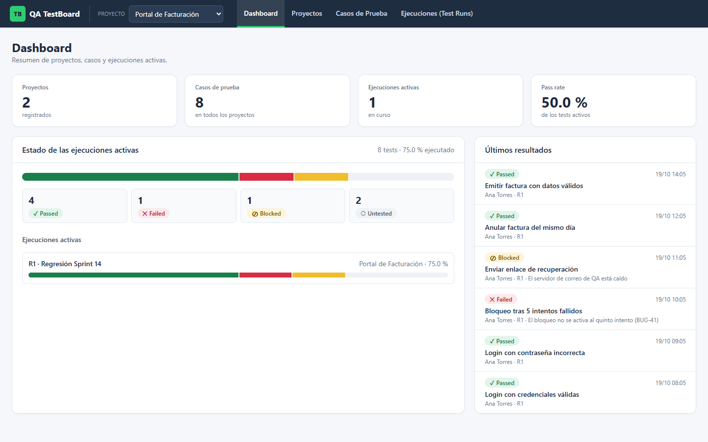

## Funcionalidades

- **Dashboard**: proyectos, casos, ejecuciones activas, pass rate, barra apilada por estado y últimos resultados.
- **Proyectos**: crear, editar y eliminar (en cascada con sus secciones, casos y ejecuciones).
- **Casos de prueba**:
  - Barra lateral de **secciones** (carpetas y subcarpetas) con el conteo de casos.
  - Tabla principal con búsqueda (título, referencia o `C12`) y filtro de prioridad.
  - Pasos "acción | resultado esperado".
- **Ejecuciones (Test Runs)**:
  - Se incluyen todos los casos o solo una selección.
  - Se registra un resultado por caso.
  - Pestañas para filtrar por estado.
  - Las ejecuciones se pueden cerrar.
- **Estados con color, ícono y texto**: **Passed** verde, **Failed** rojo, **Blocked** amarillo, **Untested** gris.
  - Failed y Blocked exigen un comentario.
- **API REST JSON** con el mismo CRUD (ver abajo).
- **Historial a prueba de borrados**: cada resultado guarda una copia del título y la sección del caso.

## Cómo ejecutarlo

### Opción A: VS Code (automático)

1. Abre la carpeta `qa-testboard` en VS Code (`code C:\Users\Pc\Downloads\qa-testboard`).
2. La primera vez, ejecuta **Terminal → Run Task… → Instalar dependencias**.
3. Cierra y vuelve a abrir la carpeta. La tarea **Iniciar servidor (Flask :5000)** arranca sola gracias a `"runOn": "folderOpen"`.
   - Si VS Code pregunta, elige **Allow automatic tasks**.
4. Abre http://localhost:5000.

### Opción B: Terminal

```powershell
cd C:\Users\Pc\Downloads\qa-testboard
python -m venv .venv
.venv\Scripts\python -m pip install -r requirements.txt
.venv\Scripts\python app.py
```

> **Puerto ocupado:** si otra aplicación usa el 5000, inicia con otro puerto: `$env:PORT=5055; .venv\Scripts\python app.py`.
> Para empezar con la base limpia, borra `instance\testboard.db`. Se recrea con los datos de ejemplo al iniciar.

### Variables de entorno (opcionales)

| Variable | Por defecto | Para qué |
|---|---|---|
| `PORT` | `5000` | Puerto del servidor |
| `DATABASE_URL` | `sqlite:///instance/testboard.db` | Otra base de datos |
| `SEED_DEMO` | `1` | `0` = no cargar datos de ejemplo |
| `SECRET_KEY` | valor de desarrollo | Firma de la sesión |

## Capturas

| Proyectos | Casos de prueba (secciones + tabla) |
|---|---|
| 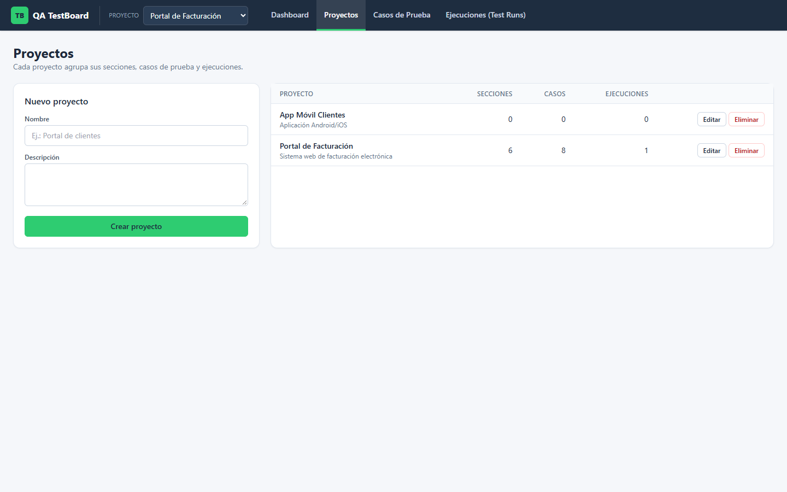 | 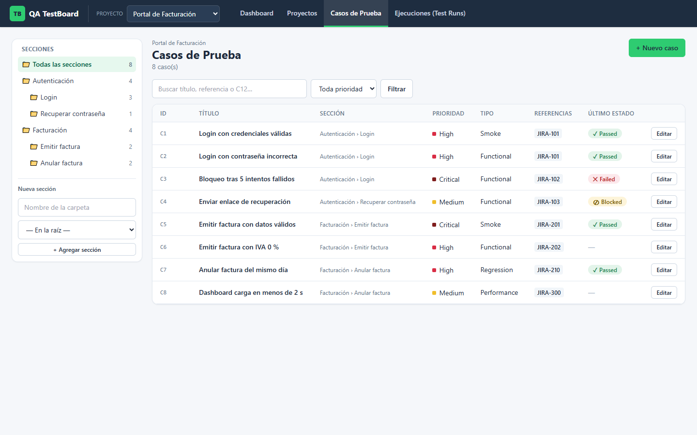 |

| Filtrar por carpeta | Detalle del caso |
|---|---|
| 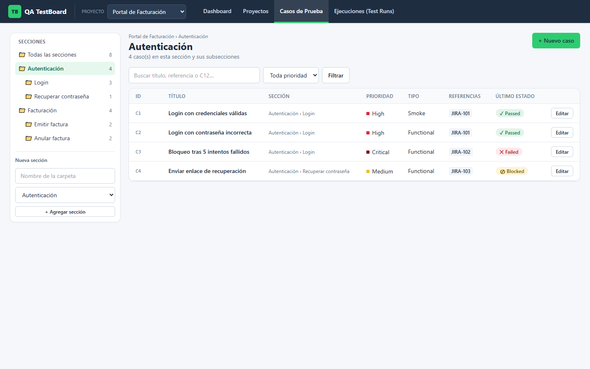 | 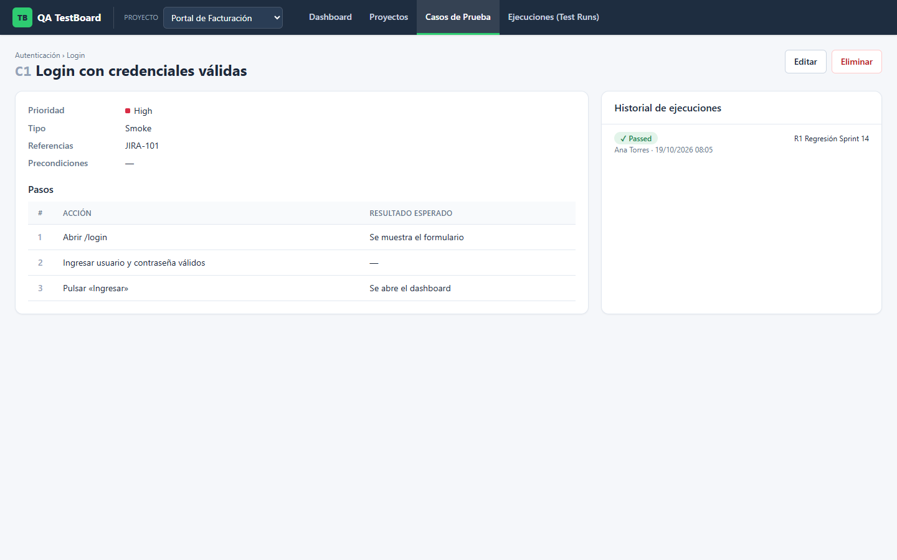 |

| Formulario del caso | Ejecuciones |
|---|---|
| 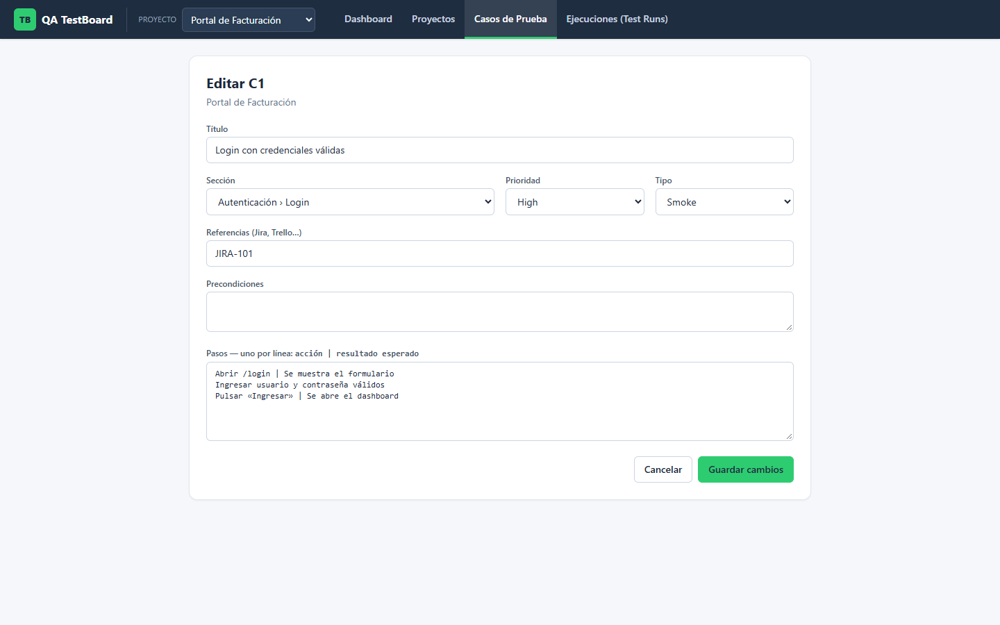 | 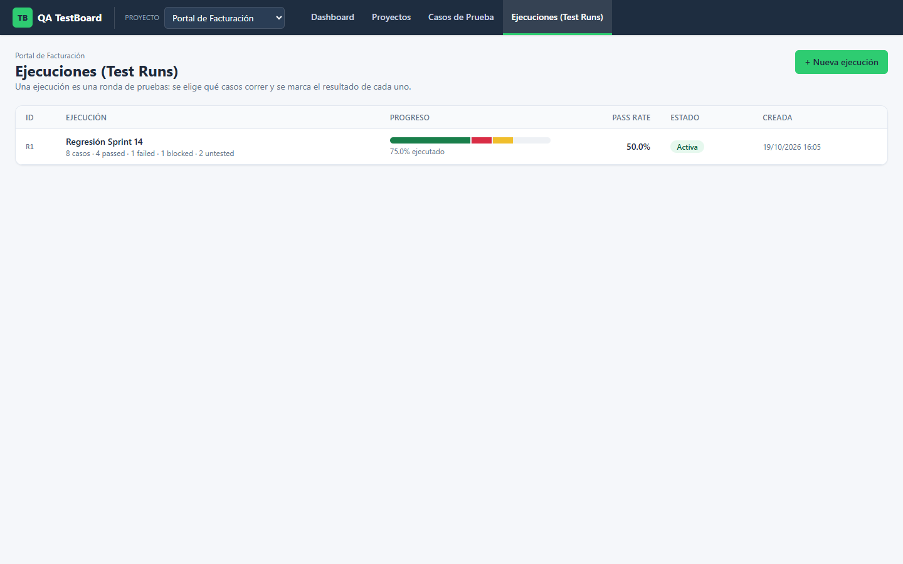 |

| Nueva ejecución (selección de casos) | Detalle de la ejecución |
|---|---|
| 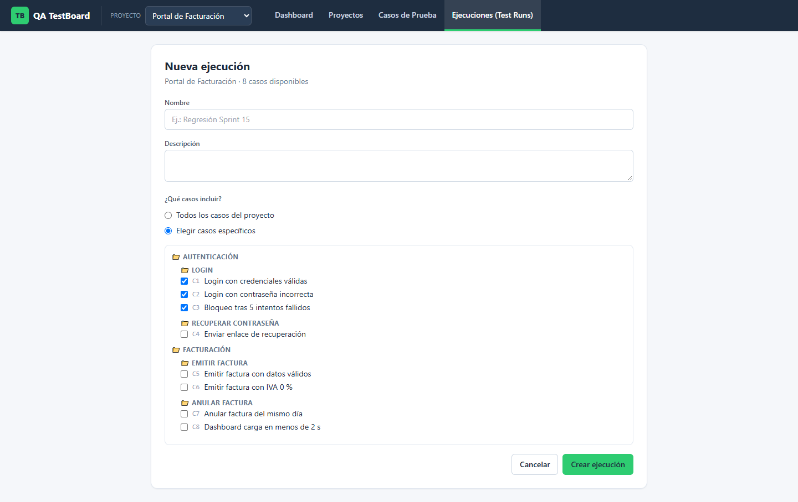 | 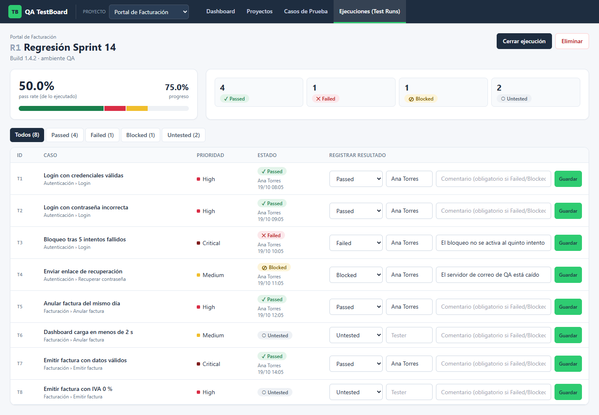 |

| Filtro por estado (Failed) | Validación: comentario obligatorio |
|---|---|
| 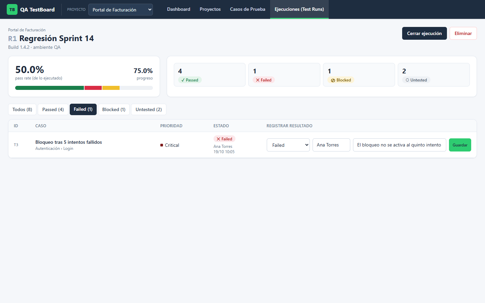 | 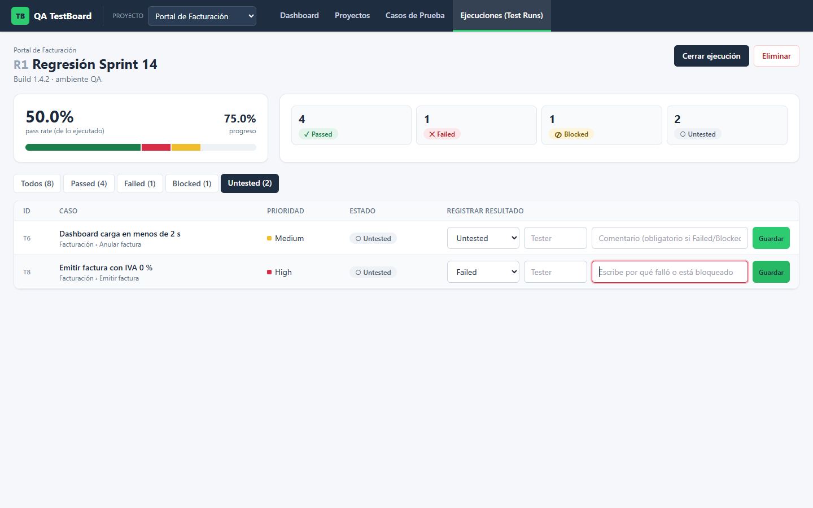 |

## Reportes de pruebas

64 pruebas con `app.test_client()` cubren:

- unitarias;
- CRUD de la API;
- validaciones 400/404;
- el flujo completo de una ejecución;
- todas las pantallas HTML.

La cobertura es del **98 %**.

```powershell
.venv\Scripts\python -m pytest                                   # o la pestaña Testing de VS Code
.venv\Scripts\python -m pytest --cov=app --cov-report=term-missing --cov-report=html   # → htmlcov/index.html
```

| Resultado de pytest | Reporte de cobertura (pytest-cov) |
|---|---|
| 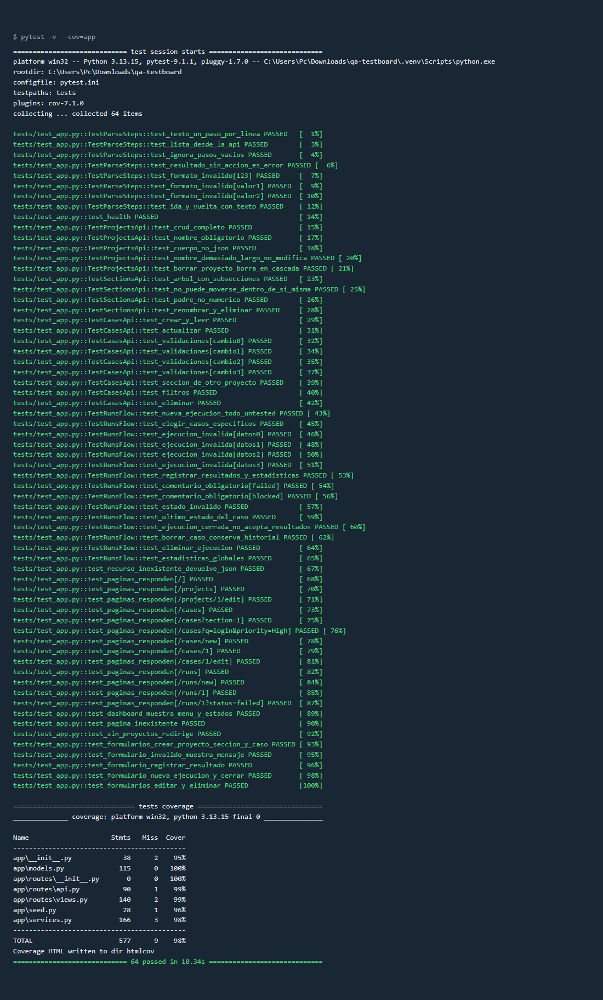 | 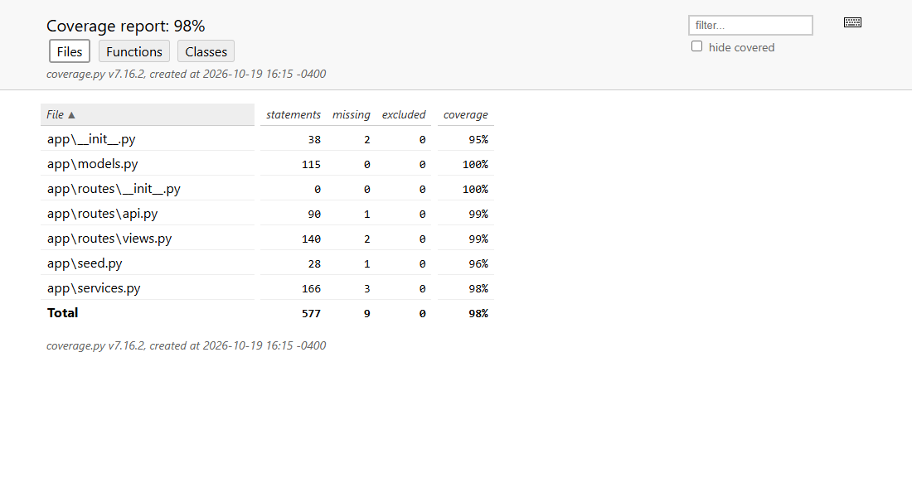 |

## Estructura

```
qa-testboard/
├── app/
│   ├── __init__.py        # create_app(): configuración, base de datos, blueprints y errores
│   ├── models.py          # Project, Section, TestCase, TestRun, TestResult (SQLAlchemy 2.x)
│   ├── services.py        # reglas de negocio y validaciones (las usan la API y las pantallas)
│   ├── seed.py            # datos de ejemplo
│   └── routes/
│       ├── api.py         # API REST JSON  (/api/...)
│       └── views.py       # pantallas HTML (formularios → redirección)
├── templates/             # Jinja: base.html, macros.html, dashboard, projects/, cases/, runs/
├── static/
│   ├── src/               # tailwind.config.js + input.css (fuente)
│   ├── css/tailwind.css   # CSS compilado (lo que carga el navegador)
│   ├── js/app.js          # confirmaciones, autoenvío, selector de casos
│   └── img/favicon.svg
├── tests/
│   ├── __init__.py
│   ├── conftest.py        # fixtures: app con base temporal, client, proyecto de ejemplo
│   └── test_app.py        # 64 pruebas
├── .vscode/
│   ├── settings.json      # pytest habilitado sobre tests/, intérprete .venv
│   └── tasks.json         # Iniciar servidor (runOn: folderOpen), pytest, cobertura, Tailwind
├── docs/                  # guía, capturas, video y scripts que los generan
├── app.py                 # punto de entrada: localhost:5000, debug=True
├── pytest.ini
└── requirements.txt       # flask, flask-sqlalchemy, pytest, pytest-cov
```

## Modelo de datos

```
Project ──< Section (árbol con parent_id) ──< TestCase
   │                                             │
   └──< TestRun ──< TestResult >─────────────────┘   (case_id queda NULL si se borra el caso)
```

## API REST

Todas las rutas responden JSON. Los errores devuelven `{"error": "..."}` con 400 (dato inválido) o 404 (no existe).

| Método | Ruta | Descripción |
|---|---|---|
| GET | `/api/health` | Estado del servicio |
| GET / POST | `/api/projects` | Listar / crear proyecto |
| GET / PUT / DELETE | `/api/projects/<id>` | Ver / editar / eliminar proyecto |
| GET / POST | `/api/projects/<id>/sections` | Árbol de secciones (con `depth`) / crear sección |
| PUT / DELETE | `/api/sections/<id>` | Renombrar o mover / eliminar (con sus casos) |
| GET / POST | `/api/projects/<id>/cases?section_id=&priority=&q=` | Listar con filtros / crear caso |
| GET / PUT / DELETE | `/api/cases/<id>` | Ver / editar / eliminar caso |
| GET / POST | `/api/projects/<id>/runs` | Listar / crear ejecución (`include_all` o `case_ids`) |
| GET / DELETE | `/api/runs/<id>` | Ver con resultados y estadísticas / eliminar |
| POST | `/api/runs/<id>/close` | Cerrar ejecución |
| PUT | `/api/results/<id>` | Registrar resultado (`status`, `comment`, `executed_by`) |
| GET | `/api/stats` | Totales globales |

Ejemplo:

```powershell
curl -X POST http://localhost:5000/api/projects -H "Content-Type: application/json" -d '{\"name\": \"Tienda\"}'
```

## Tailwind CSS

El CSS ya viene compilado en `static/css/tailwind.css`. Solo hace falta recompilar si cambias clases en las plantillas.
Necesitas Node.js. Usa la tarea **Compilar Tailwind CSS** o:

```powershell
npx tailwindcss@3 -c static/src/tailwind.config.js -i static/src/input.css -o static/css/tailwind.css --minify
```

## Regenerar capturas y video

```powershell
pip install selenium imageio imageio-ffmpeg pillow numpy   # solo para estos scripts
python docs/generar_capturas.py http://localhost:5000      # con el servidor corriendo
python docs/video/grabar_video.py                          # levanta su propio servidor temporal
```
